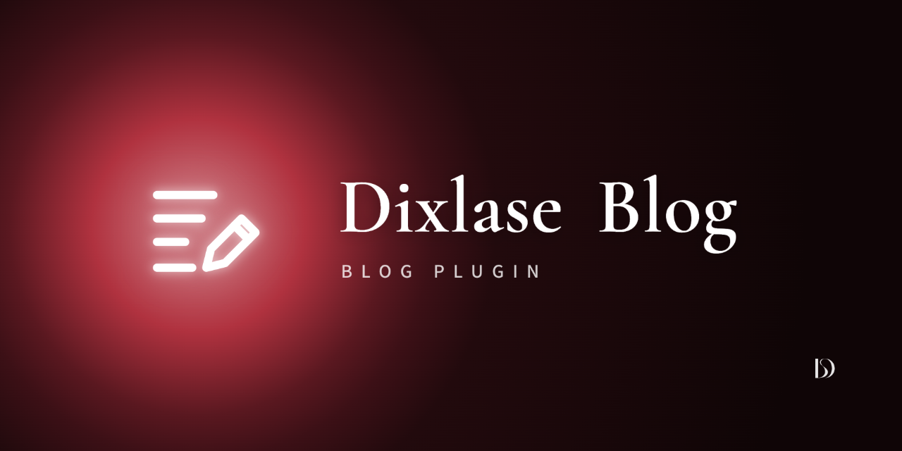

<p align="center">
  
</p>

# Dixlase Blog

English version: [README.md](./README.md)

Dixlase のブログ機能です。カテゴリーとタグ付きの記事、リビジョン、ごみ箱、承認つきのコメント、設定画面、設定できるサイドバー、検索と日付のアーカイブ、そして `/blog` 以下(この先頭部分は設定で変えられます)の一覧・記事・アーカイブ・RSS の公開ページを提供します。DixlaseSEO と組み合わせるとメタタグとサイトマップに対応します。

## 機能

### 記事を書く

- **記事** — タイトル、slug、抜粋、本文、アイキャッチ画像(コアのメディアライブラリから選択)。エディタはライブプレビューつきのコアのコンテンツエディタです。HTML エディタは管理者だけが使えます。
- **公開の流れ** — 下書き・公開・予約公開。予約公開の記事は、毎分動く `dls:blog:publish-scheduled` が、公開日時を過ぎたら公開に切り替えます。公開終了日(`closed_at`)を指定すると、その後は表示されなくなります。どの状態の記事も、管理画面からプレビューできます。
- **固定表示** — 固定表示にした記事は、一覧の先頭に出ます。
- **カテゴリー** — 3 階層まで。ドラッグするか、各行のボタン(上へ・下へ・上のカテゴリーの中へ・1 つ上の階層へ)で並べ替えます。ボタンはキーボードでも使えます。1 つの記事を複数のカテゴリーに入れられます。
- **タグ** — 記事の画面で自由に入力し、保存時に作成されます。
- **ファイル保存** — 詳細モードでは、記事の本文・CSS・JavaScript を `storage/app/private/dixlase-blog/posts/` の下にファイルで保存でき、手元で編集してデプロイできます。管理画面を通さずにファイルを変えると、公開するまで編集画面で待ち、監査ログに残ります。設定ですぐに取り込めるのは、開発環境（`APP_ENV=local`）だけです。
- **リビジョン** — 保存のたびにスナップショットを取り、いつでも復元できます。メモと、自動削除からの保護もできます。
- **ごみ箱** — 削除した記事は、復元するか完全に削除できます。
- **権限** — 編集者は記事を書いて管理できます。完全な削除、設定画面、個人情報の依頼への対応は管理者が行います。

### コメント

設定画面でオンにするまでは受け付けません。記事ごとに、ブログの設定に従うか、受け付けるか、受け付けないかを選べます。

- **承認** — すぐに公開するか、承認してから公開するかを選べます。リンクの数が上限を超えたコメントは、常に承認待ちになります。記事一覧に記事ごとの公開済みと承認待ちの数が出て、コメントの画面で 1 件ずつ、またはまとめて、承認・非公開・スパム・ごみ箱への移動ができます。
- **返信** — 何段でも入れ子にできます。編集者以上がログインしたままコメントすると、サイトとしてのコメントになり、すぐに公開されます。
- **通知メール** — 訪問者の新しいコメントを、設定画面で決めたアドレスにメールで知らせられます。
- **スパム対策** — コアの CAPTCHA(CAPTCHA の設定画面で「ブログ：コメントフォーム」をオンにします)と、1 つの IP アドレスから一定の期間に投稿できる回数の制限(設定画面で決めます。既定は 10 分間に 5 回)。
- **個人情報** — コメントした人の IP アドレスは、決めた日数だけ保存し、毎日動く `dls:blog:prune-comment-ips` で消します。個人情報の画面では、1 つのメールアドレスで書かれたコメントをすべて探し、匿名にするか削除できます。

### 公開側のページ

- **ページ** — `/blog`(一覧)、`/blog/{slug}`(記事)、`/blog/category/{slug}`、`/blog/tag/{slug}`、`/blog/{year}/{month}` と `/blog/{year}/{month}/{day}`(日付のアーカイブ)、`/blog/search?q=`(検索)、`/blog/feed.xml`(RSS)。
- **サイドバー** — 表示の有無、左右の位置、ウィジェット(検索、カテゴリー、最近の記事、月別アーカイブ、カレンダー、タグ)とその順番を設定できます。
- **記事のページ** — 前後の記事と関連記事、共有ボタン(X、Facebook、LINE、リンクのコピー)、パンくずリスト。

### 連携

- **DixlaseSEO** — メタタグ、OGP 画像、hreflang、サイトマップ。項目は DixlasePages と同じです。

## インストール

管理画面の **ダッシュボード → プラグイン** でこのプラグインを探し、ダウンロードして有効化してください。有効化するとプラグインのテーブルが自動で作成されます。

リポジトリを clone して配置した場合は、Dixlase のルートで autoload を作り直し、画面用ファイルをビルドしてください。

```bash
php scripts/sync-local-autoload.php && composer dump-autoload --no-scripts
cd plugins/DixlaseBlog && npm ci && npm run build
```

`resources/assets/` のビルドしたファイルは git で追跡していません。リリースの ZIP とデプロイのワークフローがビルドします。

## 使い方

有効にすると、管理画面のサイドバーに **ブログ管理** が出ます。記事一覧、新規作成、カテゴリー、コメント、ごみ箱、ブログ設定の画面があります。

記事の公開 URL は `/blog/{slug}` です。slug は記事の恒久的なアドレスになるので、短い英語にしてください。`/blog` の部分は設定画面で変えられます。

### ほかの本文に最新記事を載せる

ショートコード `[blog]` で、フロントページなど、コアのショートコードの処理を通る本文に最新記事を並べられます。並び順はブログのトップと同じです(固定表示の記事が先)。

| 属性 | 値 | 既定 |
|---|---|---|
| `count` | 1〜50 | `3` |
| `layout` | `cards`、`list`(日付とタイトル)、`full`(記事を全文で) | `cards` |
| `category` / `tag` | カテゴリーまたはタグの slug | すべての記事 |
| `link` | `true` / `false` — 記事の下にブログのトップへのリンクを出すか | `true` |

例: `[blog count="5" layout="list" link="false"]`。表示する記事がないときは、何も出しません。

### Markdown ファイルから記事を取り込む

管理画面の外で書いた記事（手書き、スクリプト、アシスタントなど）は、エディタを埋める代わりにコマンド 1 つで取り込める。

```bash
php artisan dls:blog:post:import drafts/hello.md --as=author@example.com --dry-run
php artisan dls:blog:post:import drafts/hello.md --as=author@example.com
php artisan dls:blog:post:import drafts/ more/post.md --as=author@example.com   # まとめて取り込む
```

（ファイルの例は英語版の README を参照）

- 記事はエディタと同じルールで検査され、同じ方法でリビジョン付きで保存される。Markdown の記事になり、**ファイルで指定しない限り下書き**になる。公開する前に管理画面で確認すること
- `--draft` を付けると、ファイルの `status` に関係なく下書きで保存する。ほかの人やアシスタントが書いた、公開前に読むべきファイル向け。公開中・予約中の記事は、サイトから取り下げずに拒否する
- そのスラッグの記事がすでにあれば**更新**する。ファイルに書かなかったキーは今の値のまま
- ファイルを書いたあとの変更を取り消すことになる更新は拒否する。書き出したファイルで `revision` が今の記事と合わないとき、または `revision` のないファイルで、記事の最後の保存が取り込み以外（管理画面など）のとき。記事を書き出し直してそのファイルを直すか、上書きするなら `--force` を付ける。取り込みで保存したリビジョンは、記事のリビジョン一覧に「取り込み」と出る
- `featured_image`・`seo.ogp_image`・本文にあるローカルの画像（相対パス）は、コアの `dls:media:import` でメディアライブラリに取り込み、本文はそれを指すように書き換える。URL と `/` で始まるサイト内のパスはそのまま。ライブラリにすでにある画像は使い回す
- ファイル全体が正しくない限り、何も保存せず、画像も取り込まない。`--dry-run` は検査だけ、`--json` は記事と使った画像を出す
- `--storage=file` / `--storage=database` で、記事の保存先を選べる。エディタの保存先の選択と同じで、新しい記事はその保存先で作り、既存の記事はそこへ移す（データベースに戻すと記事のファイルは削除される）。指定しなければ、新しい記事は Blog の既定、既存の記事は今の保存先のまま。保存先を選べるのは管理画面の詳細モードだけで、シンプルモードではこのオプションを拒否する
- ファイルとディレクトリを一度に複数渡せる。ディレクトリは、その直下の `*.md` を名前の順に取り込む。ファイルは 1 つずつ取り込み、失敗したファイルは何も保存せず、ほかのファイルは止めない。最後にまとめを出し、1 つでも失敗があればコマンドも失敗で終わる。そのとき `--json` は、ファイルごとの結果の一覧になる
- `--as` で著者を指定する。`APP_ENV` が `local` のときだけ動く（`--allow-non-local` で上書きできる）。ローカルのサイトに入れてからデプロイするためのもの
- フロントマターは YAML の小さなサブセット。`key: value`、`[a, b]` または `- item` の行によるリスト、`seo` の下の 1 段だけの字下げしたキー。それ以外は行番号付きで拒否する

### 記事を Markdown ファイルに書き出す

取り込みの逆向き。記事（たとえば、取り込んだあと管理画面で直した記事）を、取り込みが読むのと同じ形のファイルに書き出す。ファイルで続きを書き、また取り込める。

```bash
php artisan dls:blog:post:export hello-world                       # 標準出力に出す
php artisan dls:blog:post:export hello-world --output=drafts/hello.md
```

- 記事はスラッグか ID で指定する。書き出せるのは Markdown の記事だけ
- `--output` は、既にあるファイルを `--force` なしでは上書きしない
- フロントマターには、記事の項目、カテゴリ、タグ、SEO の説明文と、書き出した時点の記事の版を表す `revision` が入る
- 画像はフロントマターに書かない。取り込みは書かれていないキーを今の値のままにするので、アイキャッチと OGP の画像は残る。本文の画像はサイトのパスのまま
- ファイル保存の記事は、エディタが見せる作業中のコピーから書き出す
- 書き出したファイルを手を入れずに取り込み直しても、記事は変わらない
- 取り込みと同じく、`APP_ENV` が `local` のときだけ動く（`--allow-non-local` で上書きできる）

## テンプレートの変更

表側のページは、プラグインのテンプレートとスタイルシートで表示します。テンプレートを変えるには、`resources/views/` からファイルを次のどちらかのディレクトリへ、相対パスを保ったまま(例: `front/show.blade.php`)コピーします。最初にファイルが見つかったディレクトリのものが使われます。

1. `custom/plugins/DixlaseBlog/resources/views/` — そのサイトだけ
2. `themes/<有効なテーマ>/plugins/DixlaseBlog/resources/views/` — そのテーマだけ
3. `plugins/DixlaseBlog/resources/views/` — 標準

テンプレートは次のとおりです。

- `front/_layout`(サイドバーを含むページの枠)、`front/index`、`front/show`、`front/archive`(カテゴリー、タグ、日付、検索のページ)
- `front/_card`(一覧の記事 1 件)、`front/_pagination`、`front/_breadcrumbs`、`front/_post-nav`(前後の記事)、`front/_related`、`front/_share`
- `front/_comments`(コメントの一覧とフォーム)、`front/_comment`(コメント 1 件とその返信)
- `front/sidebar/*`(ウィジェットごとに 1 ファイル)
- `front/shortcode`(ショートコード `[blog]`)
- `front/feed`(RSS)

色はテーマの Tailwind の色とダークモードに合わせます。テンプレートをコピーせずに見た目を変えるときは、`.dixlase-blog` の `--dlsb-*` の CSS 変数を上書きします。

## ライセンス

Dixlase Blog は **デュアルライセンス** で配布されています。

- **オープンソースライセンス**: [GNU General Public License v3](./LICENSE)
- **商用ライセンス**: GPL v3 の遵守が現実的でないユースケース向けに、別途商用ライセンスを用意しています。[LICENSE.commercial](./LICENSE.commercial)(現在は草案)を参照するか、**info@dixlase.org** までご連絡ください。

各ファイルの関係の概要は [NOTICE.ja](./NOTICE.ja)([English](./NOTICE))にあります。

## コントリビューションについて

現在、外部からのコード Pull Request は受け付けていません。受付は、コア API の安定性と初期リリース後の運用状況を見極め、法務レビューを経たコントリビューターライセンス契約(CLA)を用意した上で開始します。CLA の確定後は、コントリビューションは [Dixlase 著作権ポリシー](https://github.com/Dixlase/dixlase-core/blob/main/COPYRIGHT-POLICY.ja.md) と Dixlase CLA(CONTRIBUTING.ja.md を参照)の対象になります。Issue でのバグ報告や提案は歓迎します。機能の提案の際は、[Dixlase の思想](https://dixlase.org/ja/philosophy) に目を通し、その機能がコアに属するものか、プラグインとして実現できるものかもご検討ください。方向性を揃える助けになります。

---
© 2026 exc-D inc. and Dixlase contributors
