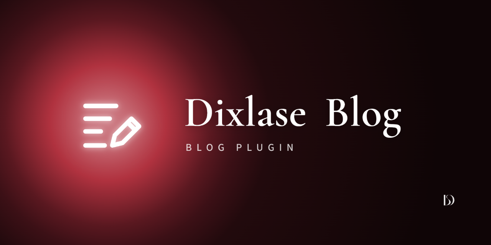

<p align="center">
  
</p>

# Dixlase Blog

For Japanese, see [README.ja.md](./README.ja.md).

A blog for Dixlase: posts with categories and tags, revisions and a trash; comments with moderation; a settings screen; a configurable sidebar; search and date archives; and public list, post, archive and RSS pages under `/blog` (the prefix is a setting). It works with DixlaseSEO for meta tags and the sitemap.

## Features

### Writing

- **Posts** — Title, slug, excerpt, body and featured image (picked from the core media library). The editor is the core content editor, with a live preview; the HTML editor is for admins only.
- **Publish workflow** — Draft / Published / Scheduled (a scheduled post turns published once its time passes, through `dls:blog:publish-scheduled`, which runs every minute), with an optional end date (`closed_at`) after which the post is hidden. A post can be previewed in any status from the admin.
- **Pinned posts** — Pinned posts come first in the list.
- **Categories** — Up to three levels. Reorder them by dragging, or with the buttons on each row (up, down, into the category above, up a level), which also work from the keyboard. A post can belong to several categories.
- **Tags** — Entered as free text on the post screen and created on save.
- **File storage** — In the advanced admin mode a post can keep its body, CSS and JavaScript as files under `storage/app/private/dixlase-blog/posts/`, to be edited locally and deployed. A change made to the files outside the admin waits on the edit screen until it is published, and is recorded in the audit log; only in a development environment (`APP_ENV=local`) can the settings take it in at once.
- **Revisions** — A snapshot on every save, restorable at any time, with notes and protection against pruning.
- **Trash** — Deleted posts can be restored or deleted permanently.
- **Roles** — Editors write and manage posts. Permanent deletion, the settings screen and personal-data requests are for admins.

### Comments

Off until the site turns them on on the settings screen. Each post can follow the blog setting, or open or close its own comments.

- **Moderation** — Publish at once, or hold for approval. A comment with more links than the limit is always held. The post list shows each post's published and pending counts, and the Comments screen approves, unpublishes, marks as spam or trashes them, one at a time or in bulk.
- **Replies** — Nested to any depth. An editor or above who is signed in comments as the site; those comments are published at once.
- **Notification mail** — Each new visitor comment can be mailed to an address set on the settings screen.
- **Spam protection** — Core's CAPTCHA (turn on "Blog: comment form" on the CAPTCHA settings screen) and a limit on comments per IP address within a period, set on the settings screen (five per ten minutes by default).
- **Personal data** — Commenters' IP addresses are kept for a set number of days and then cleared by `dls:blog:prune-comment-ips`, which runs daily. The personal data screen finds every comment written with one e-mail address, to anonymise or delete them.

### Public pages

- **Pages** — `/blog` (list), `/blog/{slug}` (post), `/blog/category/{slug}`, `/blog/tag/{slug}`, `/blog/{year}/{month}` and `/blog/{year}/{month}/{day}` (date archives), `/blog/search?q=` (search) and `/blog/feed.xml` (RSS).
- **Sidebar** — On or off, left or right, with search, categories, recent posts, monthly archives, a calendar and tags as widgets, in any order.
- **On a post** — Previous / next and related posts, share buttons (X, Facebook, LINE, copy link) and breadcrumbs.

### Integrations

- **DixlaseSEO** — Meta tags, OGP images, hreflang and the sitemap, with the same fields as DixlasePages.

## Installation

Open the admin panel under **Dashboard → Plugins**, find this plugin, then download and enable it. The plugin's tables are created automatically on enable.

When you place the plugin by cloning the repository instead, regenerate the autoloader from the Dixlase root and build the front-end assets:

```bash
php scripts/sync-local-autoload.php && composer dump-autoload --no-scripts
cd plugins/DixlaseBlog && npm ci && npm run build
```

The built files under `resources/assets/` are not tracked in git. The release ZIP and the deploy workflow build them.

## Usage

Once enabled, **Blog Management** appears in the admin sidebar with the post list, new post, categories, comments, trash and blog settings screens.

A post's public URL is `/blog/{slug}`. Use a short English slug; it is the post's permanent address. The `/blog` prefix can be changed on the settings screen.

### Latest posts in other content

The `[blog]` shortcode lists the latest posts wherever content goes through core's shortcode parser, such as the front page. They come in the blog top page's order (pinned posts first).

| Attribute | Values | Default |
|---|---|---|
| `count` | 1 to 50 | `3` |
| `layout` | `cards`, `list` (date and title), `full` (each post in full) | `cards` |
| `category` / `tag` | a category or tag slug | all posts |
| `link` | `true` / `false` — a link to the blog's top page under the posts | `true` |

For example, `[blog count="5" layout="list" link="false"]`. With no posts to show, it renders nothing.

## Customising the templates

The front pages use the plugin's own templates and stylesheet. To change a template, copy it from `resources/views/` to one of these directories, keeping its relative path (for example `front/show.blade.php`). The first directory that holds the file wins:

1. `custom/plugins/DixlaseBlog/resources/views/` — one site
2. `themes/<active theme>/plugins/DixlaseBlog/resources/views/` — one theme
3. `plugins/DixlaseBlog/resources/views/` — the defaults

The templates are:

- `front/_layout` (the page frame with the sidebar), `front/index`, `front/show` and `front/archive` (category, tag, date and search pages)
- `front/_card` (a post in a list), `front/_pagination`, `front/_breadcrumbs`, `front/_post-nav` (previous / next), `front/_related` and `front/_share`
- `front/_comments` (the comment list and form) and `front/_comment` (one comment and its replies)
- `front/sidebar/*` (one file per widget)
- `front/shortcode` (the `[blog]` shortcode)
- `front/feed` (RSS)

Colours follow the theme's Tailwind colour tokens and its dark mode; to restyle without copying a template, override the `--dlsb-*` CSS variables on `.dixlase-blog`.

## License

Dixlase Blog is distributed under a **dual license**:

- **Open Source License**: [GNU General Public License v3](./LICENSE)
- **Commercial License**: For use cases where GPL v3 compliance is not feasible, a separate commercial license is available — see [LICENSE.commercial](./LICENSE.commercial) (currently a draft) or contact **info@dixlase.org**.

A short overview of how these files fit together is in [NOTICE](./NOTICE) ([日本語](./NOTICE.ja)).

## Contributing

We do not yet accept external code Pull Requests. They will open once we have assessed core API stability and how the project operates after the initial release, and prepared a Contributor License Agreement (CLA) that has passed legal review. Once the CLA is finalized, contributions will fall under the [Dixlase Copyright Policy](https://github.com/Dixlase/dixlase-core/blob/main/COPYRIGHT-POLICY.md) and the Dixlase CLA (see CONTRIBUTING.md). Bug reports and proposals via Issues are welcome. For feature proposals, please take a look at [the Dixlase philosophy](https://dixlase.org/en/philosophy) — and consider whether the feature belongs in the core or could work as a plugin. It helps us align on direction.

---
© 2026 exc-D inc. and Dixlase contributors
